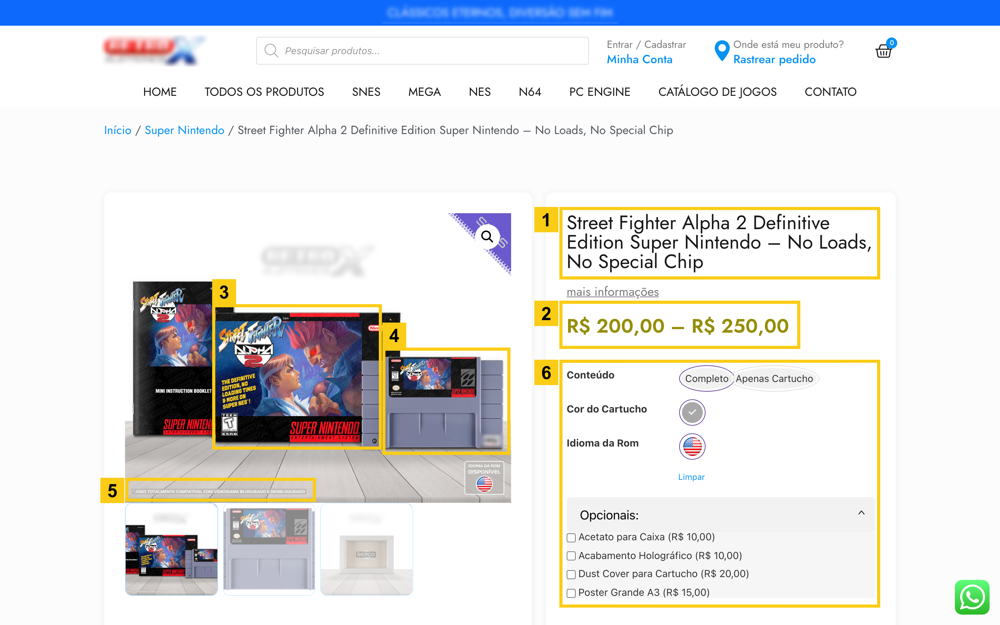
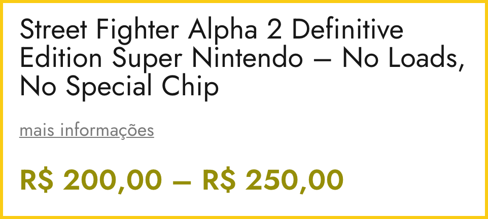
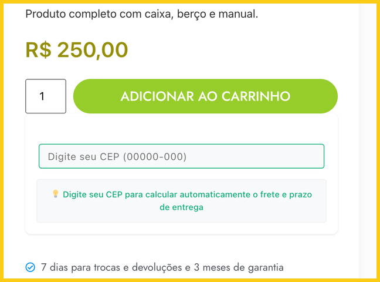
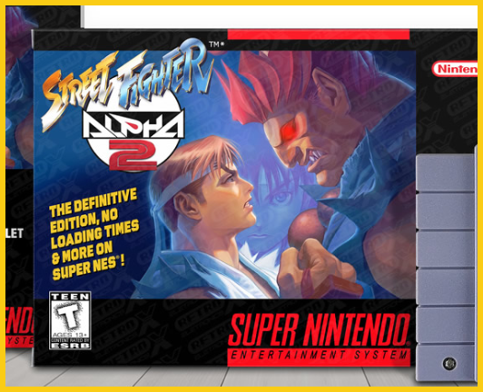
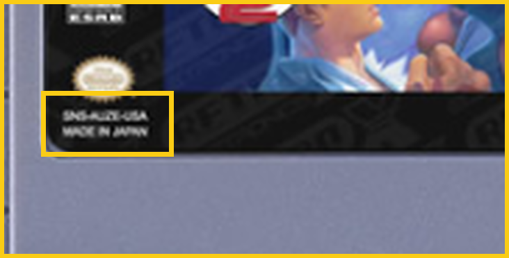
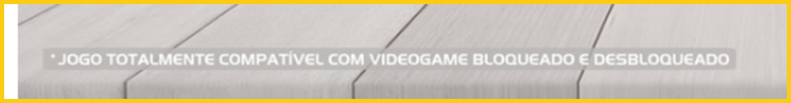
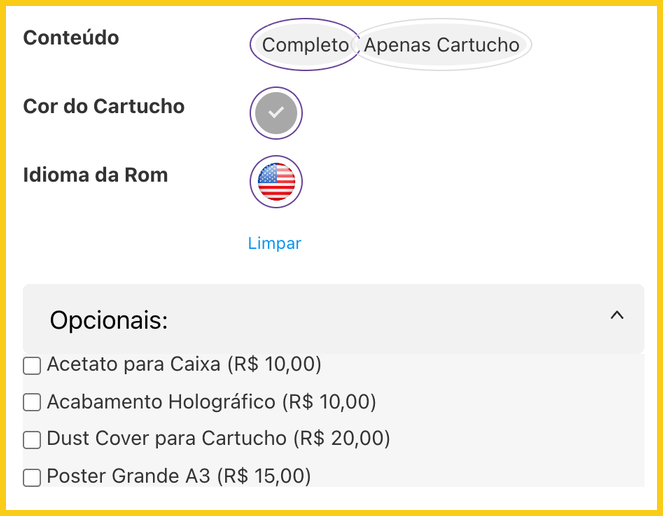
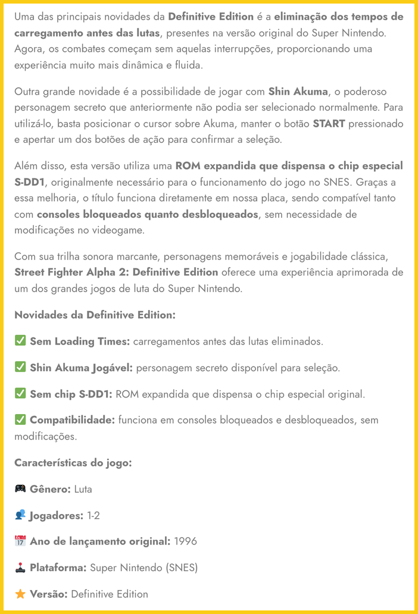

# Street Fighter Alpha 2 Definitive Edition Super Nintendo: Raubkopie-Modul, nicht kaufen

[Português](README.md) / [English](README.en.md) / [Español](README.es.md) / [Italiano](README.it.md) / [Deutsch](README.de.md) / [简体中文](README.zh-CN.md) / [日本語](README.ja.md) / [繁體中文（香港）](README.zh-HK.md)

Dieses Projekt entstand aus einem sehr persönlichen Wunsch: **einer Community, die ich liebe, die mir unglaubliche Erlebnisse geschenkt hat und von der ich weit mehr bekommen habe, als ich je zurückgeben konnte, wenigstens ein kleines Stück zurückzugeben.**

Nicht genehmigte Kopien dieses Projekts werden vom Shop **Retro-X Eletronics** unter `retroxeletronics.com.br` verkauft, unter dem Namen **"Street Fighter Alpha 2 Definitive Edition Super Nintendo"** und mit dem Slogan **"No Loads, No Special Chip"**. Wenn du über die Suche nach diesem Namen oder diesem Shop hier gelandet bist: Dieses Modul ist dieses Projekt, und ich habe den Verkauf nie genehmigt.

**Vor allem anderen: KAUFT DIESE RAUBKOPIE-MODULE NICHT. Sie sind keine fertigen Produkte, und es gibt keine finale, fehlerfreie Version, die verkauft werden könnte.**

Eines ist wichtig zu verstehen: Die erste spielbare Version wurde erst 2026 fertig, und selbst sie bekam laufend weitere Bugfixes. Die ersten Versionen waren viel zu instabil. Das wurde nie verschwiegen. Im Gegenteil, es war Teil eines offenen Entwicklungsprozesses, in dem Mitglieder der Community aktiv an den Tests teilnahmen, Probleme fanden, Bugs meldeten und halfen, Korrekturen zu bestätigen.

Wer also physische Module dieses Projekts verkauft, verkauft eine Entwicklungsversion, als wäre sie ein fertiges Produkt. **Nichts garantiert, dass das Modul in deinen Händen nicht genau eine dieser instabilen Versionen enthält.** Und da das Projekt offline genommen wurde, wird nie wieder eine Korrektur erscheinen: Die Bugs auf diesem Modul bleiben für immer darauf.

**Du weißt nicht, welche Version aufgespielt wurde. Du weißt nicht, welche Korrekturen enthalten sind. Du weißt nicht, welche Bugs noch vorhanden sind. Und du kannst nicht wissen, ob das Modul überhaupt richtig funktioniert.**

Du kannst ein Modul kaufen und auf Glitches, Abstürze, unvollständige Funktionen oder Probleme stoßen, die in späteren Versionen bereits erkannt und behoben worden waren. Du kannst mehr bezahlen als für ein Originalspiel und etwas bekommen, das nie als Endprodukt geprüft wurde.

Und hier gibt es einen grundlegenden Unterschied: Wer das Spiel auf einem Flashcart nutzte, war Teil eines gemeinsamen Prozesses aus Entwicklung, Tests und Fehlerbehebung. Man konnte die Version aktualisieren, Korrekturen testen und direkt zur Weiterentwicklung des Projekts beitragen. Wer ein ROM auf ein Modul brennt und es zum Verkauf anbietet, bietet nichts davon.

**Finanziert diesen Markt nicht, und verwechselt eine Entwicklungsversion nicht mit einem fertigen Spiel. Ihr zahlt womöglich viel Geld für etwas, das nie als fertiges Produkt hätte verkauft werden dürfen.**

## Raubkopieren ist eine Straftat

Kopien von Spielen ohne Erlaubnis der Rechteinhaber zu verkaufen ist Piraterie, und Piraterie ist in Brasilien eine Straftat. Artikel 184, Absatz 2, des brasilianischen Strafgesetzbuchs sieht 2 bis 4 Jahre Freiheitsstrafe und eine Geldstrafe für jeden vor, der mit Gewinnabsicht eine Kopie eines Werks verkauft oder zum Verkauf anbietet, die unter Verletzung des Urheberrechts hergestellt wurde.

Das gilt für die Spiele der Firmen, die sie entwickelt haben, und es gilt auch für meine Arbeit. Street Fighter Alpha 2 ist ein Spiel von Capcom. Die Änderungen, die die Ladezeiten entfernen und ohne den Spezialchip auskommen, sind meine Arbeit. Ich habe nie jemandem erlaubt, Module damit zu verkaufen.

## Das Angebot

Bildschirmfoto des Angebots vom 2026-11-10 um 14:12 GMT. Die Zahlen markieren die unten aufgeführten Details. Die Logos des Shops sind leicht unscharf gemacht; der Name des Shops steht in diesem Text.

1. Titel: "Street Fighter Alpha 2 Definitive Edition Super Nintendo", gefolgt von "No Loads, No Special Chip".

   

2. Preis: von R$ 200,00 bis R$ 250,00. Das "Produto completo com caixa, berço e manual", das komplette Set mit Schachtel, Einlage und Anleitung, kostet R$ 250,00, mit "7 dias para trocas e devoluções e 3 meses de garantia": 7 Tage Rückgaberecht und 3 Monate Garantie.

   

3. Schachtel: Auf der Vorderseite steht "The Definitive Edition, No Loading Times & More on Super NES!".

   

4. Modul: Auf dem Etikett stehen der Code `SNS-AUZE-USA` und "Made in Japan". Kein Modul dieses Projekts wurde je in Japan hergestellt. Derselbe Code steht auf der Anleitung.

   

5. Hinweis auf den Fotos: "Jogo totalmente compatível com videogame bloqueado e desbloqueado", portugiesisch für "Spiel voll kompatibel mit gesperrten und entsperrten Konsolen".

   

6. Optionen: "Completo", das komplette Set, oder "Apenas Cartucho", nur das Modul, mit kostenpflichtigen Extras: Schutzhülle für die Schachtel, holografische Veredelung, Staubschutz und ein A3-Poster.

   

7. Beschreibung, weiter unten auf der Seite: Sie bewirbt die "eliminação dos tempos de carregamento antes das lutas", das Entfernen der Ladezeiten vor den Kämpfen, und ein "ROM expandida que dispensa o chip especial S-DD1", ein erweitertes ROM, das ohne den Spezialchip S-DD1 auskommt. Genau das macht dieses Projekt.

   

Dasselbe Produkt kann in anderen Shops, auf Mercado Livre, auf Shopee oder in Facebook-Gruppen unter einem anderen Namen auftauchen. Die Details 3, 4 und 5 erkennen das Modul in jedem Angebot.

**"Definitive Edition" ist ein Name, den sich der Verkäufer ausgedacht hat. Eine endgültige Edition dieses Projekts hat es nie gegeben: Als es offline genommen wurde, bekam es noch Korrekturen.**

### Aufnahmeprotokoll

| Feld | Wert |
|---|---|
| Shop | Retro-X Eletronics |
| Adresse | `https://retroxeletronics.com.br/produto/street-fighter-alpha-2-definitive-edition-super-nintendo-no-loads-no-special-chip/` |
| Datum | 2026-11-10 14:12:34 GMT |
| Methode | Headless Chromium, Fenster 1440x900, Skalierung 2 |
| SHA-256 des Bildschirmfotos | `cb085b0749899e7b31aa1b2e0bdc4faa991862e6fd337b7d5cc7c3544cc0ca78` |
| SHA-256 der ganzen Seite | `6494f6917982b36425032cfd3b15095de6822c12948f93118a1e76707c5045e3` |
| SHA-256 des Seiten-PDFs | `bf64a3c0718ca29ca92989778df28a546d0163fb65ea0f9b73430b114ed9dee5` |

Die Originaldateien, ohne Unschärfe und mit diesen Prüfsummen, liegen bei mir.

## Häufige Fragen

### Ist dieses Modul offiziell oder genehmigt?

Nein. Ich habe nie einem Shop erlaubt, Module dieses Projekts zu verkaufen.

### Gibt es eine "Definitive Edition" dieses Projekts?

Nein. Diesen Namen hat sich der Verkäufer ausgedacht.

### Bekommt das Modul Updates?

Nein. Das Projekt wurde offline genommen, und es wird keine neuen Versionen geben. Die Bugs auf dem Modul bleiben für immer darauf.

### Kann der Verkäufer die Bugs beheben?

Es gibt keine Quelle mehr, aus der eine Korrektur kommen könnte. Die Korrekturen entstanden in der offenen Entwicklung dieses Projekts, und die ist beendet.

### Welche Version ist auf dem Modul?

Das lässt sich aus dem Angebot nicht erkennen. Es kann jede sein, auch eine der ersten, die viel zu instabil waren.

### Ich habe schon eins gekauft. Was kann ich tun?

Wenn du es in Brasilien online gekauft hast, gibt dir Artikel 49 des brasilianischen Verbraucherschutzgesetzes, des Código de Defesa do Consumidor, das Recht, innerhalb von 7 Tagen nach Erhalt zu widerrufen, mit voller Erstattung. Das Angebot selbst verspricht "7 dias para trocas e devoluções", 7 Tage Rückgaberecht. Wie du Anzeige erstattest, steht unten.

## Wie du Anzeige erstattest

Wenn du eines dieser Module gekauft hast und dich betrogen fühlst, oder wenn du dieses Projekt wegen dieses Handels verloren hast, kannst und solltest du es melden. Sichere vorher das Angebot, den Zahlungsbeleg, die Nachrichten mit dem Verkäufer und Fotos des Produkts.

### In Brasilien

- Polizei: Erstatte Anzeige, einen boletim de ocorrência, auf einer Polizeiwache oder über die Online-Wache deines Bundesstaats. Der Verkauf von Raubkopien ist nach Artikel 186 des Strafgesetzbuchs ein Offizialdelikt: Jeder kann es melden, auch ohne etwas gekauft zu haben.
- Verbraucherschutz: Reiche eine Beschwerde beim Procon deines Bundesstaats und auf [consumidor.gov.br](https://www.consumidor.gov.br) ein. Wenn du online gekauft hast, verlange die Erstattung innerhalb von 7 Tagen nach Erhalt, nach Artikel 49 des Verbraucherschutzgesetzes.
- Zahlung: Wenn du mit Karte bezahlt hast, bitte die ausgebende Bank, die Zahlung zurückzubuchen.
- Plattformen: Melde das Angebot als Verkauf eines Raubkopie-Produkts auf Mercado Livre, Shopee, Instagram, Facebook oder wo immer es auftaucht.
- Rechteinhaber: Informiere Capcom, der das Spiel gehört, über die offiziellen Kanäle.

### Außerhalb Brasiliens

- Wende dich an die Verbraucherschutzbehörde deines Landes und gib an, dass du bei einem brasilianischen Shop gekauft hast.
- Wenn du mit Karte oder PayPal bezahlt hast, eröffne einen Konflikt beim Kartenaussteller oder bei PayPal.
- Melde das Angebot auf der Plattform, auf der es erscheint.
- Wo Raubkopieren strafbar ist, erstatte Anzeige bei der örtlichen Polizei.
- Informiere Capcom über die offiziellen Kanäle.

## Warum das Projekt offline genommen wurde

Es waren sechs Jahre Arbeit, vom Beginn der Pandemie im Jahr 2020 bis zur Fertigstellung der ersten spielbaren Version im Jahr 2026. Sechs Jahre Recherche, Entwicklung, Experimente und unzählige Stunden, investiert in etwas, das nie darauf ausgelegt war, Gewinn zu erzielen. Es war ein Beitrag, den ich geleistet habe, weil ich es wollte, weil ich an die Community geglaubt habe und weil ich etwas wirklich Nützliches liefern wollte.

Eines möchte ich ganz klar sagen: **Dieses Projekt wurde nie geschaffen, um den Markt der kommerziellen Piraterie zu bedienen.** Und erst recht nicht, um denjenigen als Werkzeug zu dienen, die die Arbeit anderer zum Geschäft machen und unautorisierte Kopien von Spielen unter dem bequemen Euphemismus "Reproduktionen" verkaufen.

Wir kennen diesen Markt. Produkte von zweifelhafter Qualität, oft teurer verkauft als Originalexemplare, die gerade die Leidenschaft einer Community ausnutzen, die Respekt verdient hätte.

Das Projekt war immer vollständig Open Source, einschließlich seines Toolkits. Sein Zweck war einfach und technisch sehr spezifisch: Die Spiele sollten auf erschwinglichen Flashcarts laufen, mit allen Verbesserungen, die ich entwickeln konnte, ohne zusätzliche Hardware, proprietäre Geräte oder irgendeine FPGA-basierte Lösung.

**Und genau das habe ich geliefert.**

Der Verhaltenskodex war nicht zufällig da. Er existierte genau dafür, Grenzen zu setzen, die Community zu schützen und klarzustellen, welche Art der Nutzung ich für akzeptabel hielt.

Leider gibt es Berichte und Beweise dafür, dass meine Arbeit in Brasilien ohne Genehmigung verkauft wird, getarnt unter dem bequemen Etikett "Reproduktionsmodule".

Wer das tut, gehört genau zu den Leuten, denen dieses Projekt nie nützen sollte. Menschen, die nichts zur Entwicklung beigetragen, die Nutzungsbedingungen nicht respektiert und in der Arbeit eines anderen nur eine Gelegenheit gesehen haben, Geld zu verdienen.

Deshalb habe ich eine Entscheidung getroffen: Das Projekt wurde offline genommen. Es wird keinen Support, keine neuen Veröffentlichungen und keine Releases mehr geben. Das gilt auch für Material, das bereits fertig war und nach den letzten Tests nur noch auf die Veröffentlichung wartete.

Ich werde nicht weiter meine Zeit, mein Wissen und meine Arbeit investieren, nur um am Ende kostenlos Rohmaterial für einen Markt zu liefern, der den Prinzipien, aus denen dieses Projekt entstanden ist, grundlegend widerspricht.

Es ist zutiefst enttäuschend, nach sechs Jahren Hingabe an diesem Punkt anzukommen. Aber meine Bereitschaft, etwas zur Community beizutragen, bedeutet nicht, dass ich verpflichtet bin, die kommerzielle Ausbeutung meiner Arbeit hinzunehmen.

**Meine Arbeit wurde der Community geschenkt. Nicht dem Markt für raubkopierte Module. Verwechselt Großzügigkeit nicht mit der Erlaubnis, die Arbeit anderer auszubeuten.**

An alle, die positiv beigetragen, Wissen geteilt und die ursprüngliche Idee respektiert haben: mein aufrichtiger Dank.

Was diejenigen betrifft, die beschlossen haben, daraus ein Geschäft zu machen: Ich hoffe, ihr versteht, dass eure Entscheidungen Konsequenzen haben.

**Bedankt euch bei denen, die beschlossen haben, einen kostenlosen Beitrag für die Community in ein Geschäft mit Raubkopien zu verwandeln. Ihr wisst, wer ihr seid.**

Ich weiß, wie viel Zeit ich hineingesteckt habe. Ich weiß, was ich geliefert habe, und vor allem weiß ich, warum ich es getan habe. Ich habe keinerlei Verpflichtung, meine Arbeit weiterhin denen zur Verfügung zu stellen, die sich entscheiden, sie auf diese Weise auszubeuten.
